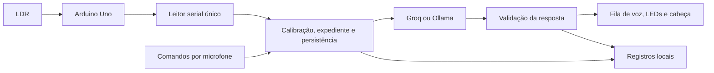

# Energia que dá Lucro — MADARA

Global Solution 2026.2 · CitizenTech · Engenharia de Software 4ES · Maker Lab.

## Vídeo de demonstração

**Link do vídeo:** _Adicione aqui o link da gravação._

## Ficha técnica do MVP

| Campo | Descrição |
|---|---|
| Produto | Energia que dá Lucro |
| Público beneficiado | Donos e funcionários de pequenos comércios de bairro no Brasil |
| Problema | Dificuldade para perceber possíveis desperdícios de energia na rotina do comércio |
| Proposta | Observar a iluminação, relacionar os dados ao expediente e orientar uma verificação humana |
| Componente deste repositório | Robô MADARA com Arduino Uno, LDR, voz, LEDs e cabeça motorizada |
| Cenário inicial | Estoque com pouca iluminação natural |
| Inteligência artificial | Groq na nuvem ou Ollama no computador; processamento fora do Arduino |
| Dados | Registros locais e custo estimado quando houver parâmetros cadastrados |
| Indicadores | Quantidade e duração de ocorrências; custo estimado disponível; economia real exige comparação antes/depois |
| Escopo atual | Monitoramento físico, avisos autônomos, expediente por voz e consultor de energia |
| ODS relacionados | 9, 11 e 13: tecnologia aplicada ao comércio e redução potencial de desperdícios |

O MADARA é o componente físico do produto. Integração por rede com painel/API,
medição de corrente, PIR e acionamento de lâmpadas ficam fora deste MVP.
O LDR observa claridade: **não comprova lâmpada ligada, ausência de pessoas,
consumo elétrico ou economia obtida**.

## Como funciona

1. O Arduino recebe o sinal do LDR e o Python acompanha a entrada configurada.
2. O programa aplica calibração, expediente e persistência mínima.
3. Claridade durante o expediente não gera suspeita automaticamente. Fora dele,
   uma condição persistente solicita análise contextual da IA.
4. Uma análise validada orienta o aviso. Em falha, há contingência identificada.
5. O robô fala, acende os LEDs e faz um balanço breve da cabeça. A ocorrência
   mantém o mesmo UUID e é finalizada quando a observação termina.

Exemplo: “Possível desperdício de iluminação. A claridade no estoque persiste
fora do expediente. Verifique sua origem e necessidade.”



Leitura serial, avaliação temporal, análise automática e avisos usam tarefas
separadas. A coleta continua durante silêncio, fala, consulta à IA e comandos.
[Arquitetura e decisões técnicas](docs/MAKER_LAB.md).

## Componentes e conexões

| Componente | Conexão na montagem atual |
|---|---|
| Arduino Uno | USB com o computador |
| Módulo LDR digital | **VCC → 5V, GND → GND, DO → pino 8** |
| LED vermelho | Pino 9, resistor de 220 Ω e GND |
| LED azul | Pino 10, resistor de 220 Ω e GND |
| Ponte H | ENA → 3, IN1 → 4, IN2 → 5 |
| Motor DC da cabeça | OUT1/OUT2 da ponte H; fonte compatível própria e terra comum |
| Boneco existente | Modelo editável em `modelos3d/Madara_Maker_CP2.f3d` |

O motor não é alimentado diretamente pelo 5V do Uno. Confira as conexões com
as fontes desligadas. Posicione o **LDR longe dos LEDs e das sombras da cabeça**;
o próprio aviso não deve interferir na condição observada.

Também existe suporte analógico em **A0**, selecionado explicitamente:

- **LDR avulso:** exige divisor resistivo. Exemplo de topologia: 5V → LDR → A0
  → resistor fixo → GND. A resistência deve ser adequada à faixa da montagem.
- **Módulo com AO:** a saída analógica vai a A0; identifique alimentação e
  pinos pelas inscrições/datasheet do módulo real. A ordem dos pinos não é presumida.
- **Módulo somente DO:** mantenha DO → 8. DO não fornece intensidade analógica.

O sentido das leituras depende da montagem e é determinado pela calibração.
O código não troca de sensor automaticamente quando há uma falha.

## Instalação

Use Python **3.10 ou superior**. Execute os comandos no PowerShell, na raiz do
projeto. Crie um ambiente virtual em cada computador; não copie a `.venv`.

```powershell
python -m venv .venv
.venv\Scripts\Activate.ps1
python -m pip install -r requirements-microfone.txt
if (-not (Test-Path -LiteralPath .env)) { Copy-Item -LiteralPath .env.example -Destination .env }
```

| Arquivo de dependências | Quando usar |
|---|---|
| `requirements-microfone.txt` | Maker Lab com comandos por voz; inclui as dependências de avisos |
| `requirements-maker.txt` | Maker Lab com avisos, sem reconhecimento de voz ou câmera |
| `requirements.txt` | Assistente completa antiga, incluindo webcam e utilidades |

Simulação e testes automatizados usam a biblioteca padrão, com dublês de
hardware, áudio e rede. O caminho Maker não exige os SDKs de Groq/Ollama.

### Configurar a IA

No `.env` local, preencha sua chave e escolha o provedor. Este exemplo contém
apenas um placeholder:

```dotenv
GROQ_API_KEY=coloque_sua_chave_aqui
MAKER_IA_PROVEDOR=groq
MAKER_IA_MODELO=openai/gpt-oss-20b
MAKER_SENSOR_TIPO=digital
```

O modelo deve estar disponível na sua conta. Para Ollama, use
`MAKER_IA_PROVEDOR=ollama`, configure `MAKER_IA_MODELO` e mantenha o servidor
local na porta 11434 com esse modelo instalado.

Prioridade: **ambiente do processo → `.env` → padrões**. A chave no `.env`
já atende; não é obrigatório cadastrá-la no Windows. Não compartilhe `.env`
nem coloque chaves no `.env.example`.

### Conferir firmware e calibrar

1. Confira `arduino/madara_arduino/madara_arduino.ino`. Grave o sketch
   manualmente pela Arduino IDE quando necessário; o programa não faz upload.
2. Feche o Monitor Serial e outras instâncias que estejam usando a placa.
3. Execute os diagnósticos separadamente:

```powershell
python testar_arduino.py --sensor
python testar_arduino.py --calibrar
```

No modo digital, cubra e ilumine o LDR: DO deve alternar entre **0 e 1**.
Se houver trimpot, ajuste-o para distinguir as condições. A calibração coleta
5 segundos de escuro e 5 de iluminado e imprime as referências para o `.env`.
Ela **não edita o arquivo**. Repita se os níveis forem iguais ou instáveis.

Na montagem validada pela equipe, escuro correspondeu a 1 e iluminado a 0.
Isso não é uma regra universal: use os valores medidos na sua montagem.
Sem calibração, o monitor não deve interpretar claro/escuro.

## Executar

Execução principal com microfone e síntese offline:

```powershell
python maker_lab.py --voz --microfone --voz-motor pyttsx3
```

| Comando | Finalidade |
|---|---|
| `python maker_lab.py` | Monitor físico com diagnóstico no terminal |
| `python maker_lab.py --voz` | Avisos falados, sem microfone |
| `python maker_lab.py --voz --microfone` | Avisos e comandos por voz |
| `python maker_lab.py --diagnostico-ia` | Conferir conexão/modelo, sem gerar resposta ou abrir a serial |
| `python testar_arduino.py 30` | Testar LEDs e cabeça com balanço curto |
| `python maker_lab.py --demonstracao` | Demonstração acelerada e explicitamente simulada |
| `python madara.py` | Assistente completa com funções antigas |

Use **Ctrl+C** para encerrar e liberar recursos. O monitor e o teste de
hardware devem usar a porta serial separadamente. `ARDUINO_PORTA` permite
selecioná-la quando a detecção automática não encontrar a placa.

`--voz-motor pyttsx3` torna a síntese offline. O reconhecimento do microfone
continua usando Google e precisa de internet; Groq também requer conexão.
Durante silêncio, o microfone permanece aberto entre as esperas internas e
“Ouvindo…” aparece uma vez por sessão. A captura pausa ao processar uma frase
e durante a reprodução, com proteção contra reconhecer a própria fala.

## Comandos por voz

| Exemplo, começando com “Madara” | Resposta/ação |
|---|---|
| “Como está a iluminação?” | Consulta local da leitura e condição atuais |
| “Há quanto tempo a luz está acesa?” | Duração observada da claridade, sem comprovar lâmpada ligada |
| “Explique o último alerta.” | Consulta ao alerta e à justificativa registrados |
| “Mostrar resumo de energia.” | Estado, ocorrências e eventual espera entre avisos |
| “Quanto custou essa ocorrência?” | Estimativa calculada localmente ou indisponibilidade |
| “Como posso economizar energia no estoque?” | Consultor especializado, com contexto pertinente |
| “Configurar horário de funcionamento.” | Diálogo de abertura/fechamento com confirmação |
| “Qual é o horário de funcionamento configurado?” | Consulta local do expediente |
| “Pausar monitoramento.” / “Retomar monitoramento.” | Controla a avaliação, mantendo a coleta |
| “Encerrar a assistente.” | Encerra a execução |

Perguntas locais não são enviadas indiscriminadamente à LLM. O consultor
responde brevemente em português, recusa assuntos fora de energia e encaminha
intervenções na instalação a um profissional qualificado. As funções antigas
permanecem em `madara.py`: [referência histórica](docs/ASSISTENTE_ORIGINAL.md).

### Expediente por voz

Diga “Madara, configurar horário de funcionamento” ou informe os dois horários:
“Madara, a loja abre às sete da manhã e fecha às nove da noite”.

O guia pergunta abertura e fechamento separadamente. Aceita “sete e meia da
manhã”, `07:00`, `21:00` e “meia-noite”. “Às sete” exige esclarecimento.
O robô repete os horários e pede **“confirmo”** ou **“cancelar”**. Falha de
captura, ambiguidade ou ausência de confirmação não aplica a alteração.

O expediente é diário, em Brasília (`-03:00`); `22:00–06:00` fecha no dia
seguinte. Horários iguais são rejeitados; não há calendário de feriados.
Durante o guia, pode responder sem “Madara” nas janelas anunciadas: 8 s para
começar, frase até 15 s e diálogo até 120 s.

Os horários confirmados são salvos em `expediente.json`, sem reescrever `.env`.
**Para os horários, esse arquivo prevalece sobre a configuração inicial.**
Uma mudança efetiva encerra a observação ativa com auditoria e reinicia a
persistência, preservando o estado de pausa. Dados anteriores permanecem históricos.

## Regras e parâmetros principais

| Parâmetro | Padrão / significado |
|---|---|
| `MAKER_ABERTURA` / `MAKER_FECHAMENTO` | 07:00 / 21:00 iniciais; o expediente salvo pode substituí-los |
| `MAKER_REFERENCIA_ESCURO` / `MAKER_REFERENCIA_CLARO` | Devem ser medidas; digital usa níveis distintos 0/1 |
| `MAKER_PERSISTENCIA_S` | 60 s contínuos antes da análise |
| `MAKER_PAUSA_ALERTA_S` | 300 s mínimos entre avisos distintos |
| `MAKER_MAX_SEM_LEITURA_S` | 3 s para considerar dados desatualizados |
| `MAKER_IA_TIMEOUT_S` | 10 s de orçamento para a análise |
| `MAKER_MOTOR_AVISO` | true; false desativa a cabeça nos avisos |
| `MAKER_MOTOR_BALANCO_MS` | 30 ms por trecho; aceita 10..60 |
| `MAKER_MOTOR_DURACAO_S` | 2 s de movimento; aceita duração positiva até 5 s |
| `MAKER_POTENCIA_KW` / `MAKER_TARIFA_RS_KWH` | Opcionais, sem valores assumidos |

Demais parâmetros: [.env.example](.env.example).

Uma ocorrência contínua avisa uma vez. Uma nova análise pode acontecer durante
o intervalo entre avisos; o terminal informa a espera. O aviso só é solicitado
ao liberar o intervalo se a condição continuar ativa. Resolução, pausa ou
encerramento impedem fala tardia. “Solicitado” significa enfileirado, sem
comprovar reprodução física.

O motor acompanha o início do aviso e para mesmo se a fala continuar. O retorno
ao centro é estimado por tempo, sem sensor de posição. A avaliação e a coleta
continuam durante o movimento.

## IA e confiabilidade

`IAGenerativa` mantém operações próprias para análise automática da iluminação,
conversa profissional de energia e chatbot antigo de personagem. Os prompts
não se misturam. O Uno não executa a LLM: o Python prepara o contexto, controla
durações, valida respostas e calcula custos.

A análise automática exige `classificacao`, `justificativa`, `recomendacao` e
`mensagem_falada`. Categorias: `normal`, `possivel_desperdicio` e
`dados_insuficientes`. O contexto identifica calibração, qualidade/idade da
leitura e o indício temporal confirmado. Uma classificação incompatível com
esse indício ativo é rejeitada, sem apresentar uma regra local como decisão da IA.

Uma saída inválida pode ter **uma revisão**, usando o restante do orçamento.
Rede, autenticação e cota não têm novas tentativas automáticas. Persistindo a
falha, há aviso `contingencia_deterministica` e auditoria do motivo. A proteção
não garante correção semântica de toda resposta da LLM.

## Protocolo e registros

Serial a **9600 baud**, mensagens por linha, LF ou CRLF:

```text
PRONTO v4 CAPS=LEDS_SEPARADOS,LDR_ANALOGICO,LUZ_DIGITAL
TEL:LDR:712:1500
LUZ:0
```

`H` consulta capacidades; `L` solicita DO em 8; `O/o` controlam ambos os LEDs,
`V/A` selecionam vermelho/azul e `G/P` controlam a cabeça. No digital, o leitor
único consulta DO a cada 1 s. A telemetria ADC em A0 chega a cada 500 ms e tem
cache separado. Firmware v3 atende o digital legado; analógico exige a capacidade
anunciada. Linhas inválidas não renovam a atualidade.

Arquivos em `dados/maker/`, ou na pasta escolhida por `--pasta` ou
`MAKER_DADOS_DIR`. Use um processo por pasta e por porta serial.

| Arquivo | Conteúdo |
|---|---|
| `leituras.jsonl` | Leituras observadas e instante com fuso |
| `auditoria.jsonl` | Estados, análise, revisões, falhas e motivos de encerramento |
| `estado_ativo.json` | Checkpoint da ocorrência ativa |
| `expediente.json` | Horários confirmados por voz |
| `eventos.jsonl` | Ocorrências encerradas com custo conhecido, contrato compartilhado |
| `eventos_pendentes.jsonl` | Registro local de custo desconhecido explícito, `null` |

O evento final contém exatamente:

| Campo | Formato |
|---|---|
| `id` | UUID estável da ocorrência |
| `loja_id` / `equipamento_id` | IDs configurados conforme o guia |
| `tipo` | `luz_acesa_sem_necessidade`, uma suspeita para verificação |
| `origem` | `maker` no físico; `simulador` na demonstração |
| `inicio` | ISO 8601 com fuso |
| `duracao_s` | Inteiro positivo |
| `custo_estimado_rs` | Número no contrato exportável |

O evento é finalizado quando escurece, abre a loja, muda o expediente, pausa,
perde dados ou encerra o monitor. Falta de comunicação encerra o período na
última leitura válida; reinício usa o checkpoint sem contar o tempo desligado.
A exportação é deduplicada por UUID.

Estimativa: `potencia_kw × duracao_s / 3600 × tarifa_rs_kwh`.
Cadastre potência nominal total e tarifa com fontes verificáveis. Não há
potência, tarifa ou fator de perda de refrigeração assumidos. Sem parâmetros,
o registro fica pendente: **desconhecido não é custo zero**. Após configurá-los,
exporte com `python maker_lab.py --exportar-pendentes`.

## Integrantes

| Nome | RM |
|---|---|
| Natan Eguchi dos Santos | RM98720 |
| João Pedro Marques Rodrigues | RM98307 |
| Gustavo Henrique Santos Bonfim | RM98864 |
| Kayky Paschoal Ribeiro | RM99929 |
| Lucas Yuji Farias Umada | RM99757 |
